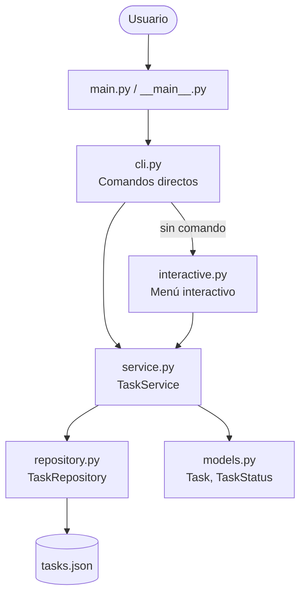
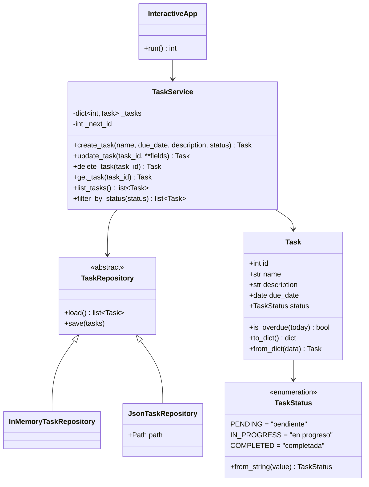

# Arquitectura y Diseño

## Visión general

El sistema sigue una **arquitectura en capas**: cada capa solo conoce a la
inmediatamente inferior. Así, cambiar la interfaz (por ejemplo, a una web) o
el almacenamiento (por ejemplo, a una base de datos) no afecta la lógica de
negocio.

| Capa | Módulo | Responsabilidad |
|------|--------|-----------------|
| Presentación | `cli.py`, `interactive.py` | Leer datos del usuario, mostrar resultados y errores |
| Aplicación | `service.py` | Casos de uso: crear, editar, eliminar, listar y filtrar |
| Dominio | `models.py`, `exceptions.py` | Entidad `Task`, estados y reglas de validación |
| Persistencia | `repository.py` | Cargar y guardar las tareas |

## Diagrama de clases

## Decisiones de diseño

### 1. Estructura de datos: diccionario indexado por id

`TaskService` guarda las tareas en un `dict[int, Task]`. Buscar, editar y
eliminar por id cuesta O(1), y listar ordena por id en O(n log n). Para el
volumen esperado en una aplicación personal de tareas es más que suficiente y
mantiene el código simple.

### 2. Validación en el modelo

`Task` es un `dataclass` que valida sus datos en `__post_init__`: nombre no
vacío, fecha en formato ISO y estado válido. Por eso **no puede existir una
tarea inválida** en ninguna parte del sistema. Al editar, el servicio construye
una copia con `dataclasses.replace`, que también se valida, antes de
reemplazar la original. Si algún valor es inválido, la tarea queda intacta.

### 3. Patrón Repositorio

`TaskService` depende de la interfaz abstracta `TaskRepository`, no de un
archivo concreto (principio de inversión de dependencias). Esto permite:

- usar `InMemoryTaskRepository` en las pruebas unitarias, que son rápidas y no
  tocan el disco;
- usar `JsonTaskRepository` en producción;
- añadir en el futuro, por ejemplo, un `SqliteTaskRepository` sin modificar el
  servicio.

### 4. Persistencia JSON segura

- **Escritura atómica**: se escribe en un archivo temporal y luego se
  reemplaza el original con `os.replace`. Si el programa se interrumpe a mitad
  del guardado, el archivo anterior sigue íntegro.
- **No se sobrescriben archivos dañados**: si el JSON no se puede leer, se
  lanza `StorageError` y el programa termina sin tocar el archivo.
- **Formato versionado** (`"version": 1`) para facilitar migraciones futuras.

### 5. Ids no reutilizables

El siguiente id se calcula como el máximo existente + 1. Una tarea recién
creada nunca recibe el id de otra que todavía existe.

### 6. Dos interfaces sobre el mismo servicio

Los comandos directos (`cli.py`) y el menú (`interactive.py`) son capas de
presentación delgadas: traducen la entrada del usuario a llamadas de
`TaskService` y comparten las funciones de formato (`format_table`,
`format_detail`). Ninguna contiene lógica de negocio.

### 7. Inyección de dependencias para pruebas

`main()` e `InteractiveApp` aceptan el servicio, los flujos de salida y la
función de entrada como parámetros opcionales. Las pruebas pueden simular al
usuario sin necesidad de *mocks* complejos.

### 8. Manejo de errores

| Error | Origen | Tratamiento |
|-------|--------|-------------|
| `ValueError` | Datos inválidos (fecha, nombre, estado) | Mensaje `Error: ...`, código de salida 1. En el menú, se vuelve a preguntar. |
| `TaskNotFoundError` | Id inexistente | Mensaje `Error: ...`, código de salida 1 |
| `StorageError` | Archivo ilegible o sin permisos | Mensaje `Error: ...`, código de salida 1 |
| Error de uso | Argumentos mal escritos | Ayuda de `argparse`, código de salida 2 |

## Buenas prácticas aplicadas

- Separación de responsabilidades: un módulo por responsabilidad.
- Código conforme a PEP 8, con *type hints* en todas las funciones públicas.
- *Docstrings* en módulos, clases y funciones principales.
- Excepciones propias con jerarquía (`TaskManagerError` como base).
- Sin dependencias externas, por lo que se ejecuta en cualquier instalación de
  Python 3.10+.
- Desarrollo incremental con pruebas en cada commit (ver historial de Git).
