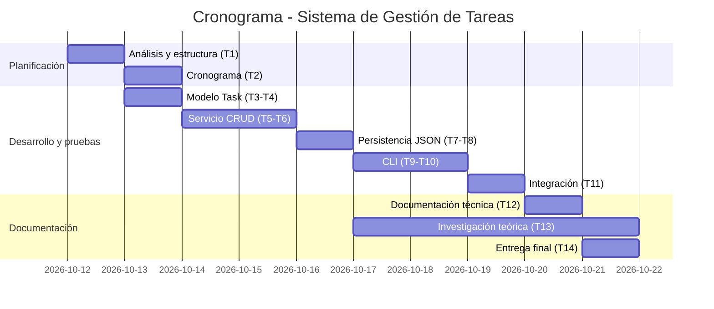

# Planificación y Cronograma de Desarrollo

## Metodología

Se adopta un enfoque **iterativo-incremental** inspirado en Kanban: cada
funcionalidad se implementa junto con sus pruebas unitarias y se integra en
un commit independiente, dejando trazabilidad en el historial de Git.

Tablero de seguimiento: Trello/Asana con las columnas
`Por hacer → En progreso → En revisión → Hecho`.

## Desglose de tareas (WBS) y estimación

| ID | Tarea | Fase | Estimación (h) | Dependencias |
|----|-------|------|---------------:|--------------|
| T1 | Análisis de requerimientos y estructura del proyecto | Planificación | 2 | — |
| T2 | Elaborar cronograma en Trello/Asana | Planificación | 1 | T1 |
| T3 | Modelo de dominio `Task` y enumeración de estados | Desarrollo | 2 | T1 |
| T4 | Pruebas unitarias del modelo | Pruebas | 1 | T3 |
| T5 | Servicio de tareas: crear, editar, eliminar, listar, filtrar | Desarrollo | 3 | T3 |
| T6 | Pruebas unitarias del servicio | Pruebas | 2 | T5 |
| T7 | Persistencia en archivo JSON | Desarrollo | 2 | T5 |
| T8 | Pruebas unitarias de persistencia | Pruebas | 1 | T7 |
| T9 | Interfaz de línea de comandos (argparse) | Desarrollo | 3 | T5, T7 |
| T10 | Pruebas unitarias de la CLI | Pruebas | 2 | T9 |
| T11 | Pruebas de integración | Pruebas | 2 | T9 |
| T12 | Documentación técnica y reporte de pruebas | Documentación | 3 | T11 |
| T13 | Respuestas teóricas e investigación (APA 7) | Investigación | 8 | — |
| T14 | Informe final y empaquetado de la entrega | Entrega | 2 | T12, T13 |
| | **Total estimado** | | **34 h** | |

La estimación se realizó mediante **juicio experto** y descomposición
(*bottom-up*), con un margen de contingencia implícito del ~15 % en las
tareas de mayor incertidumbre (CLI e investigación).

## Cronograma (2 semanas)

| Día | Tareas |
|-----|--------|
| 1 | T1, T2 |
| 2 | T3, T4 |
| 3–4 | T5, T6 |
| 5 | T7, T8 |
| 6–7 | T9, T10 |
| 8 | T11 |
| 9 | T12 |
| 6–10 (en paralelo) | T13 |
| 10 | T14 |

## Riesgos identificados

| Riesgo | Probabilidad | Impacto | Mitigación |
|--------|-------------|---------|------------|
| Subestimar el tiempo de la investigación teórica | Media | Alto | Trabajarla en paralelo desde el día 6 |
| Archivo de datos corrupto o inexistente | Media | Medio | Manejo de errores al cargar y creación automática |
| Regresiones al añadir funcionalidades | Media | Medio | Pruebas unitarias en cada incremento |
| Fechas con formato inválido | Alta | Bajo | Validación con `datetime.date.fromisoformat` |
