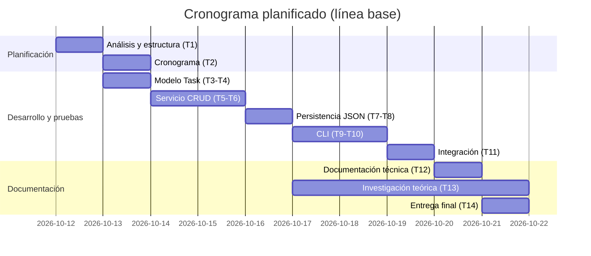

# Planificación y Cronograma de Desarrollo

## Metodología

Se adopta un enfoque **iterativo-incremental** inspirado en Kanban: cada
funcionalidad se implementa junto con sus pruebas unitarias y se integra en
un commit independiente, dejando trazabilidad en el historial de Git.

Tablero de seguimiento: Asana, con las columnas
`Por hacer → En progreso → En revisión → Hecho` (ver
[Seguimiento en Asana](#seguimiento-en-asana)).

## Desglose de tareas (WBS) y estimación

| ID | Tarea | Fase | Estimación (h) | Dependencias |
|----|-------|------|---------------:|--------------|
| T1 | Análisis de requerimientos y estructura del proyecto | Planificación | 2 | — |
| T2 | Elaborar cronograma en Asana | Planificación | 1 | T1 |
| T3 | Modelo de dominio `Task` y enumeración de estados | Desarrollo | 2 | T1 |
| T4 | Pruebas unitarias del modelo | Pruebas | 1 | T3 |
| T5 | Servicio de tareas: crear, editar, eliminar, listar, filtrar | Desarrollo | 3 | T3 |
| T6 | Pruebas unitarias del servicio | Pruebas | 2 | T5 |
| T7 | Persistencia en archivo JSON | Desarrollo | 2 | T5 |
| T8 | Pruebas unitarias de persistencia | Pruebas | 1 | T7 |
| T9 | Interfaz de línea de comandos y menú interactivo | Desarrollo | 3 | T5, T7 |
| T10 | Pruebas unitarias de la CLI y del menú | Pruebas | 2 | T9 |
| T11 | Pruebas de integración | Pruebas | 2 | T9 |
| T12 | Documentación técnica y reporte de pruebas | Documentación | 3 | T11 |
| T13 | Respuestas teóricas e investigación (APA 7) | Investigación | 8 | — |
| T14 | Informe final y empaquetado de la entrega | Entrega | 2 | T12, T13 |
| | **Total estimado** | | **34 h** | |

La estimación se realizó mediante **juicio experto** y descomposición
(*bottom-up*), con un margen de contingencia implícito del ~15 % en las
tareas de mayor incertidumbre (CLI e investigación).

## Cronograma planificado (línea base de 2 semanas)

El cronograma se elaboró como línea base de referencia, repartiendo las 34 h
estimadas en 10 días hábiles.

| Día | Tareas |
|-----|--------|
| 1 | T1, T2 |
| 2 | T3, T4 |
| 3–4 | T5, T6 |
| 5 | T7, T8 |
| 6–7 | T9, T10 |
| 8 | T11 |
| 9 | T12 |
| 6–10 (en paralelo) | T13 |
| 10 | T14 |

## Seguimiento en Asana

El avance se gestionó en el proyecto de Asana **"MIS 101 – Sistema de Gestión
de Tareas"**, con vistas de lista, tablero, cronograma y Gantt. Cada tarjeta
corresponde a una tarea de la tabla anterior e incluye en su descripción la
fase, la estimación, las dependencias y la evidencia que la cierra (commit de
Git, archivo de pruebas o documento).

## Planificado frente a real

| ID | Tarea | Estimado (h) | Fecha planificada | Fecha real | Estado | Evidencia |
|----|-------|-------------:|-------------------|------------|--------|-----------|
| T1 | Análisis y estructura del proyecto | 2 | 12 oct | 10 oct | Hecho | `99c55d2` |
| T2 | Cronograma en Asana | 1 | 13 oct | 10 oct | Hecho | Tablero de Asana |
| T3 | Modelo `Task` y estados | 2 | 13 oct | 10 oct | Hecho | `7343ec1` |
| T4 | Pruebas del modelo | 1 | 13 oct | 10 oct | Hecho | `7343ec1` (13 pruebas) |
| T5 | Servicio de tareas (CRUD y filtro) | 3 | 14–15 oct | 10 oct | Hecho | `6086d84` |
| T6 | Pruebas del servicio | 2 | 14–15 oct | 10 oct | Hecho | `6086d84` (19 pruebas) |
| T7 | Persistencia JSON | 2 | 16 oct | 10 oct | Hecho | `6e5739c` |
| T8 | Pruebas de persistencia | 1 | 16 oct | 10 oct | Hecho | `6e5739c` (11 pruebas) |
| T9 | CLI y menú interactivo | 3 | 17–18 oct | 10 oct | Hecho | `8e35095` |
| T10 | Pruebas de la CLI y del menú | 2 | 17–18 oct | 10 oct | Hecho | `8e35095` (42 pruebas) |
| T11 | Pruebas de integración | 2 | 19 oct | 10 oct | Hecho | `98dd3cf` (8 pruebas) |
| T12 | Documentación técnica y reporte de pruebas | 3 | 20 oct | 10 oct (versión inicial) | En revisión | `6111c3e` |
| T13 | Respuestas teóricas e investigación | 8 | 17–21 oct | 10 oct | Hecho | Informe en .docx |
| T14 | Informe final y entrega | 2 | 21 oct | — | En progreso | — |

**Análisis de la desviación.** La ejecución se adelantó respecto a la línea
base: las tareas de desarrollo y pruebas, que estaban planificadas para dos
semanas, se completaron en una sola jornada (10 de octubre), como muestra el
historial de commits. La desviación es favorable en plazo, y se explica en
parte por el enfoque incremental: al escribir las pruebas junto con cada
módulo no hubo retrabajo al integrar las capas ni al añadir el menú
interactivo, que no estaba en el alcance original.

No se registraron las horas reales por tarea, así que la comparación se hace
sobre fechas y no sobre esfuerzo. Como lección para próximos proyectos, conviene
registrar el tiempo dedicado a cada tarea (por ejemplo, con el registro de
horas de Asana) para calibrar las estimaciones con datos propios y no solo con
juicio experto. La documentación (T12) quedó en revisión porque falta integrar
las capturas del tablero de Asana, y la entrega (T14) sigue en curso.

## Riesgos identificados

| Riesgo | Probabilidad | Impacto | Mitigación |
|--------|-------------|---------|------------|
| Subestimar el tiempo de la investigación teórica | Media | Alto | Trabajarla en paralelo desde el día 6 |
| Archivo de datos corrupto o inexistente | Media | Medio | Manejo de errores al cargar y creación automática |
| Regresiones al añadir funcionalidades | Media | Medio | Pruebas unitarias en cada incremento |
| Fechas con formato inválido | Alta | Bajo | Validación con `datetime.date.fromisoformat` |
